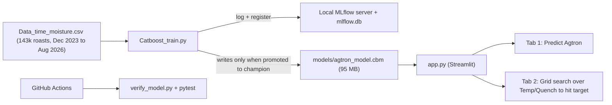

# Agtron Score Predictor: Production Readiness Review

## 1. What the project does now

A **CatBoost regression model** that predicts a coffee roast's **Agtron color score** (17–59 in your data, lower = darker). It uses five roast inputs. A **Streamlit app** serves the model and also includes a small "what-if" recommender.



| File | Role |
|---|---|
| [Catboost_train.py](file:///c:/Users/anand/Agtron_score_predictor/Catboost_train.py) | Loads the CSV and does an 80/10/10 random split. Trains CatBoost (depth 10, 3000 iterations), logs to MLflow, and promotes the new model to `champion` if its RMSE is lower |
| [app.py](file:///c:/Users/anand/Agtron_score_predictor/app.py) | Streamlit UI. Tab 1 makes a single prediction. Tab 2 tries 21×11 Temp/Quench offsets and returns the closest match to the target Agtron |
| [tests/test_model.py](file:///c:/Users/anand/Agtron_score_predictor/tests/test_model.py) | Checks the feature names and that one prediction falls in 15–65 |
| [verify_model.py](file:///c:/Users/anand/Agtron_score_predictor/verify_model.py) | Nearly the same check as the test |
| [deploy.yaml](file:///c:/Users/anand/Agtron_score_predictor/.github/workflows/deploy.yaml) | CI: installs dependencies and runs the verify script and pytest. It does **not** deploy anything |

**Features:** `Consumed`, `Temp`, `Quench` (numeric), plus `Month` and `Blend` (categorical, 249 blends).
**Unused columns:** `Roaster` (8 machines), `Time`, `Moisture`, `Produced`.

---

## 2. Bugs and correctness problems (fix these first)

> [!WARNING]
> These are the kinds of issues an interviewer would find if they read the code closely.

### Training pipeline
3. **The random split leaks information.** Roasts of the same blend on the same day are almost identical rows. `train_test_split` with shuffling puts near-duplicates in both train and test, so the reported metrics look better than they really are. Use a **time-based split**: train on older data and test on the most recent N months.

### Streamlit app
8. **Free-text Blend accepts blends the model has never seen.** Use a `selectbox` filled with the blends from training.
10. **Inputs have no upper limits.** Temp and Quench have none, so a user can enter values far outside the training range (Temp 341–547) and get a meaningless prediction.

> [!CAUTION]
> **Check whether the data can be public.** `Data_time_moisture.csv` looks like real production data, possibly from an employer. Before you put this repo on a public resume, get permission or **anonymize it**: rename blends and roasters, and shift dates. Alternatively, publish a synthetic sample instead.

---

## 3. Production-grade target architecture

### Proposed repo layout
```
agtron-predictor/
├── src/agtron/
│   ├── config.py          # pydantic-settings: paths, MLflow URI, feature list, bounds
│   ├── schema.py          # Pydantic RoastInput / Prediction models (validation lives here)
│   ├── data.py            # load + validate (pandera), clean, time-based split
│   ├── features.py        # single source of truth for feature engineering
│   ├── train.py           # CLI: train → evaluate → register → promote
│   ├── evaluate.py        # metrics, per-blend errors, baseline comparison, plots
│   ├── predict.py         # load model, predict (batch-safe)
│   └── recommend.py       # vectorized, constrained search
├── api/main.py            # FastAPI: /health, /predict, /recommend
├── app/streamlit_app.py   # thin UI that only calls predict/recommend (or the API)
├── tests/                 # unit + integration tests, using a tiny fixture model
├── configs/train.yaml     # hyperparameters
├── Dockerfile, docker-compose.yml (api + ui + mlflow)
├── pyproject.toml         # pinned deps; [dev] extras; ruff/mypy/pytest config
├── .pre-commit-config.yaml
├── Makefile               # make train / test / serve / lint
├── MODEL_CARD.md
└── README.md              # problem, architecture diagram, metrics, demo GIF, live link
```

### Prioritized roadmap

| Phase | Work | Resume value |
|---|---|---|
| **P0: Correctness** (1–2 days) | Fix bugs 3–12. Use a time-based split. Add a Blend dropdown and input bounds. Vectorize the recommender | Shows ML rigor and avoids embarrassing interview questions |
| **P1: Engineering basics** (2–3 days) | Move logic out of the Streamlit script into the `src/` package. Add Pydantic input validation, pinned `pyproject.toml`, ruff + mypy + pre-commit, a README with an architecture diagram, and clean up `.gitignore`. Remove binaries from git (Git LFS, DVC, or download from the MLflow registry or a GitHub Release at startup) | Clean, readable code that reviewers can follow |
| **P2: Better ML** (2–4 days) | Add a baseline (per-blend mean) so you can say "X% better than baseline". Try `Roaster` (and `Time`, if it is set before the roast) as features. Tune with Optuna using time-series CV and early stopping, aiming for under 10 MB with similar accuracy. Report error per blend and per roaster, residual plots, and **SHAP** feature importance. Add **prediction intervals** (CatBoost `RMSEWithUncertainty` or quantile models). Write a model card | Stronger data science story backed by measurable results |
| **P3: Serving and MLOps** (3–5 days) | Add a FastAPI service and Dockerfile. Upgrade CI to lint, test, build the image, and deploy (Render, Fly.io, HF Spaces, or Cloud Run). Add a scheduled retraining workflow with automatic champion/challenger promotion. Log predictions and add data-drift checks (Evidently). Add a `/health` endpoint and structured logging | "End-to-end MLOps", the part that stands out on a resume |
| **P4: Better recommender** (optional) | Use constrained optimization (`scipy.optimize` or Optuna) over Temp, Quench, and Time. Limit the search to each blend's observed 5th–95th percentile, prefer the smallest change from current settings, and show the uncertainty of each recommendation | Shows you can turn predictions into decisions, which strengthens the story |

### Data columns to watch for leakage
- `Produced` and `Moisture` are measured **after** the roast. Correctly, they are not used as features. Note this in the README, because it shows you understand target leakage.
- `Time`: use it only if roast time is set **before** the roast. If it comes out of the roast, it leaks the answer.

---

## 4. Test plan for a production version
- **Unit tests:** input schema validation (bad blend, out-of-range temp), Blend normalization, recommender bounds and ordering, feature-builder output columns and dtypes.
- **Model tests:** prediction is monotonic in Temp for a fixed blend (higher temp should mean darker, i.e. a lower Agtron). Holdout MAE is below a set threshold. The new model beats the baseline.
- **API tests:** `/predict` and `/recommend` happy paths and 422 validation errors, using FastAPI `TestClient`.
- **CI:** use a small fixture model trained on a sample in under 5 seconds, so tests don't need the 95 MB file.

---

## 5. Example resume bullets (fill in real numbers after P0/P2)

- Built an end-to-end ML system that predicts coffee roast color (Agtron) from roaster settings using **CatBoost** on **143K production roasts**. It reaches **MAE of X.X** on a time-based holdout, **Y% better than the per-blend baseline**.
- Built an **inverse-optimization recommender** that suggests temperature and quench settings to hit a target roast color within operating limits, cutting trial roasts by an estimated Z%.
- Set up **MLOps**: MLflow experiment tracking and model registry with automatic champion/challenger promotion, Dockerized **FastAPI** + **Streamlit** serving, and GitHub Actions CI/CD with lint, tests, and deployment.
- Added **SHAP** explainability, prediction intervals, and data-drift monitoring to support operator trust and model retraining decisions.

> [!TIP]
> The strongest resume line is a **business result**. If operators at the roastery actually use this, measure fewer re-roasts, less waste, or less time spent dialing in, and lead with that number.
