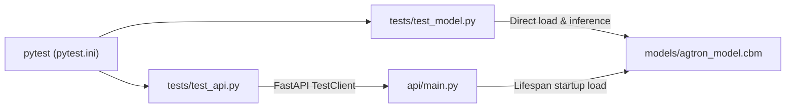

# Test Suite Documentation (`test_api.py` & `test_model.py`)

This document explains how the automated test suite in [`tests/`](file:///c:/Users/anand/Agtron_score_predictor/tests) verifies both the underlying **CatBoost regression artifact** ([`tests/test_model.py`](file:///c:/Users/anand/Agtron_score_predictor/tests/test_model.py)) and the **FastAPI REST serving layer** ([`tests/test_api.py`](file:///c:/Users/anand/Agtron_score_predictor/tests/test_api.py)).

---

## 1. Architecture Overview



| File | Scope | What It Verifies | Number of Tests |
|---|---|---|---|
| [`tests/test_model.py`](file:///c:/Users/anand/Agtron_score_predictor/tests/test_model.py) | Model Artifact Unit Test | Direct CatBoost `.cbm` loading, expected feature names/order, DataFrame dtypes, and prediction sanity range | 1 |
| [`tests/test_api.py`](file:///c:/Users/anand/Agtron_score_predictor/tests/test_api.py) | REST API Integration Tests | `/health`, `/predict`, `/recommend`, input normalization, `422 Unprocessable Entity` validation rules, and structured JSONL prediction logging | 13 |

---

## 2. [`tests/test_model.py`](file:///c:/Users/anand/Agtron_score_predictor/tests/test_model.py) — Model Artifact Test

[`tests/test_model.py`](file:///c:/Users/anand/Agtron_score_predictor/tests/test_model.py) tests the serialized CatBoost model file (`models/agtron_model.cbm`) directly, independent of any web framework.

### [`test_model_prediction()`](file:///c:/Users/anand/Agtron_score_predictor/tests/test_model.py#L5-L45)
1. **Loads the Model Artifact:**
   Instantiates `CatBoostRegressor()` and loads `models/agtron_model.cbm`.
2. **Validates Feature Schema & Ordering (Lines 10–19):**
   Confirms that `model.feature_names_` has exactly 5 features in the exact order expected during training:
   ```python
   expected_features = ["Consumed", "Temp", "Quench", "Month", "Blend"]
   assert model.feature_names_ == expected_features
   assert len(model.feature_names_) == 5
   ```
   *Why this matters:* CatBoost relies on consistent column ordering and categorical feature indices (`Month` and `Blend`). If a retrained model accidentally drops or reorders columns, this check catches it immediately.
3. **Constructs a Sample Input DataFrame (Lines 21–35):**
   Builds a 1-row `pandas.DataFrame` representing a typical coffee roast (`Consumed=500.0`, `Temp=440.7`, `Quench=73`, `Month="1"`, `Blend="284"`) and explicitly casts dtypes (`string` for categorical features, `float64`/`int` for numeric features).
4. **Verifies Prediction Output Range (Lines 39–42):**
   Runs `model.predict(sample)[0]` and asserts the predicted Agtron score falls within the realistic commercial Agtron bounds:
   ```python
   assert prediction is not None
   assert 15 <= prediction <= 65
   ```

---

## 3. [`tests/test_api.py`](file:///c:/Users/anand/Agtron_score_predictor/tests/test_api.py) — FastAPI Service Tests

[`tests/test_api.py`](file:///c:/Users/anand/Agtron_score_predictor/tests/test_api.py) tests the HTTP endpoints defined in [`api/main.py`](file:///c:/Users/anand/Agtron_score_predictor/api/main.py) using FastAPI's `TestClient` (powered by Starlette and `httpx`).

### Module Setup & Fixture

- **Path Resolution (Lines 10–12):**
  Ensures the project root is on `sys.path` (complementing [`pytest.ini`](file:///c:/Users/anand/Agtron_score_predictor/pytest.ini)) so `from api.main import app` works regardless of how `pytest` is invoked.
- **[`client()`](file:///c:/Users/anand/Agtron_score_predictor/tests/test_api.py#L17-L21) Fixture (`scope="module"`):**
  ```python
  @pytest.fixture(scope="module")
  def client() -> Iterator[TestClient]:
      with TestClient(app) as test_client:
          yield test_client
  ```
  - Entering `with TestClient(app)` triggers the FastAPI [`lifespan`](file:///c:/Users/anand/Agtron_score_predictor/api/main.py#L96-L101) startup hook, which loads `models/agtron_model.cbm` into `app.state.model` and computes its SHA-256 hash.
  - Using `scope="module"` ensures the 95 MB model is loaded **only once** for the entire test file rather than reloaded on every test function, keeping total test runtime under 2 seconds.

---

### Test Functions Breakdown

#### 1. [`test_health_endpoint(client)`](file:///c:/Users/anand/Agtron_score_predictor/tests/test_api.py#L24-L35)
- **Endpoint:** `GET /health`
- **What it checks:**
  - HTTP status code is `200 OK`.
  - `status` is `"ok"` and `model_loaded` is `True`.
  - `model_version` is a non-empty SHA-256 hex digest (not `"unavailable"`) and matches `model_hash`.

#### 2. [`test_predict_happy_path(client)`](file:///c:/Users/anand/Agtron_score_predictor/tests/test_api.py#L38-L54)
- **Endpoint:** `POST /predict`
- **Payload:**
  ```json
  {
    "Consumed": 500.0,
    "Temp": 440.0,
    "Quench": 73.0,
    "Month": "1",
    "Blend": "284"
  }
  ```
- **What it checks:**
  - HTTP status code is `200 OK`.
  - Response JSON contains `predicted_agtron` within the valid `[15.0, 65.0]` range.
  - Response JSON includes a non-empty `model_version` string.

#### 3. [`test_predict_normalizes_blend_and_accepts_lowercase_fields(client)`](file:///c:/Users/anand/Agtron_score_predictor/tests/test_api.py#L57-L68)
- **Endpoint:** `POST /predict`
- **What it checks:**
  - Compares a canonical request (`"Blend": "284"`, `"Month": "1"`, capitalized keys) against a request using lowercase field aliases and unnormalized values (`"blend": " 284.0 "`, `"month": 1`).
  - Confirms [`RoastInput`](file:///c:/Users/anand/Agtron_score_predictor/api/main.py#L104-L185) normalizes both inputs to the exact same DataFrame and returns identical `predicted_agtron` values.

#### 4. [`test_recommend_happy_path(client)`](file:///c:/Users/anand/Agtron_score_predictor/tests/test_api.py#L71-L97)
- **Endpoint:** `POST /recommend`
- **Payload:** Standard roast parameters plus `"target_agtron": 45.0`.
- **What it checks:**
  - HTTP status code is `200 OK`.
  - `current_predicted_agtron` and `expected_agtron` are within `[15.0, 65.0]`.
  - `recommended_temp` (`300.0`–`600.0 °F`) and `recommended_quench` (`0.0`–`150.0 lb`) are within operating bounds.
  - `top_recommendations` returns exactly **5 candidates**, sorted in ascending order by `error` (distance from target).
  - The first candidate in `top_recommendations` matches `recommended_temp` and `recommended_quench`.

#### 5. [`test_invalid_inputs_return_422(client, endpoint, invalid_payload)`](file:///c:/Users/anand/Agtron_score_predictor/tests/test_api.py#L100-L158)
Uses `@pytest.mark.parametrize` to test **8 invalid input scenarios**, verifying that Pydantic validation in [`RoastInput`](file:///c:/Users/anand/Agtron_score_predictor/api/main.py#L104-L185) rejects bad requests with HTTP `422 Unprocessable Entity` before touching the model:

| Case | Endpoint | Invalid Field & Value | Validation Rule Triggered |
|---|---|---|---|
| `invalid_payload0` | `/predict` | `"Temp": 150.0` | `Temp` below minimum (`ge=300.0`) |
| `invalid_payload1` | `/predict` | `"Temp": 750.0` | `Temp` above maximum (`le=600.0`) |
| `invalid_payload2` | `/predict` | `"Quench": -5.0` | `Quench` below minimum (`ge=0.0`) |
| `invalid_payload3` | `/predict` | `"Consumed": 0.0` | `Consumed` must be strictly positive (`gt=0.0`) |
| `invalid_payload4` | `/predict` | `"Blend": "99999"` | Unknown blend code (not in `KNOWN_BLENDS`) |
| `invalid_payload5` | `/predict` | `"Blend": "invalid"` | Non-numeric blend string |
| `invalid_payload6` | `/predict` | `"Month": "13"` | Month outside `1`–`12` (`VALID_MONTHS`) |
| `invalid_payload7` | `/recommend` | `"target_agtron": 95.0` | `target_agtron` outside `[15.0, 65.0]` |

#### 6. [`test_predict_logs_structured_jsonl_record(client, tmp_path, monkeypatch)`](file:///c:/Users/anand/Agtron_score_predictor/tests/test_api.py#L162-L194)
- **Endpoint:** `POST /predict`
- **What it checks:**
  - Points `PREDICTION_LOG_PATH` to an isolated temporary JSONL file (`tmp_path / "predictions.jsonl"`).
  - Calls `POST /predict` with valid roast parameters.
  - Verifies a single JSON line is appended containing `timestamp`, `event` (`"prediction"`), `endpoint` (`"/predict"`), input features (`Consumed`, `Temp`, `Quench`, `Month`, `Blend`), `predicted_agtron`, `model_version`, and non-negative `latency_ms`.

---

## 4. How to Run the Tests

Run the entire suite from the repository root:
```powershell
pytest -v
```

Run only the API tests or only the model test:
```powershell
pytest tests/test_api.py -v
pytest tests/test_model.py -v
```

